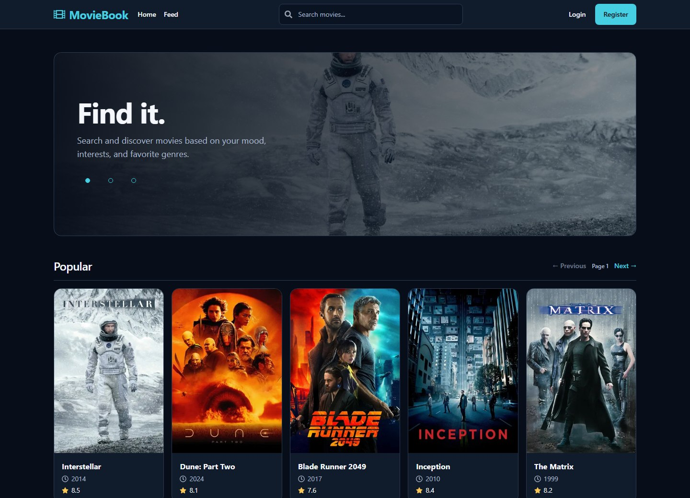
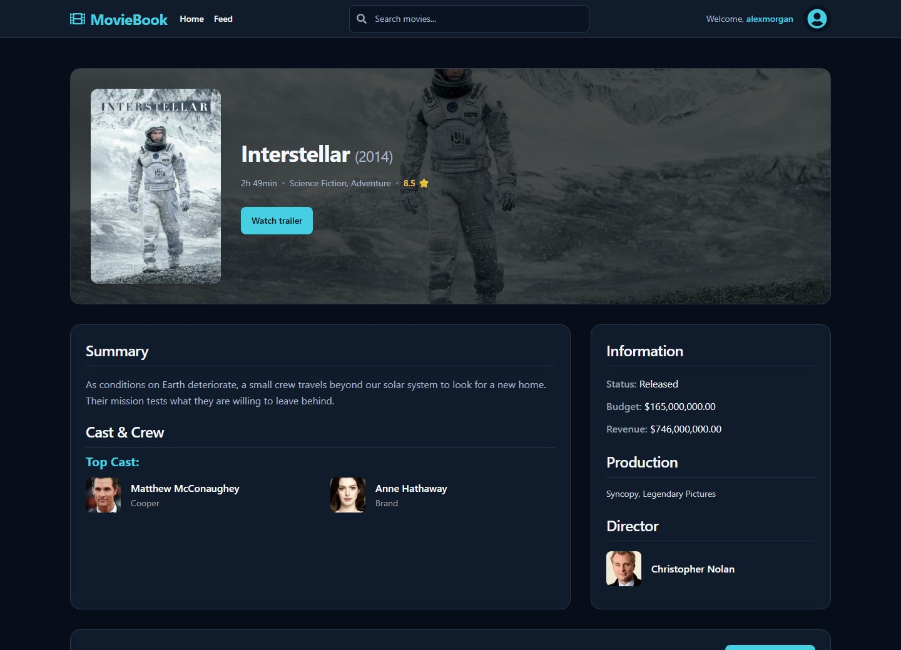
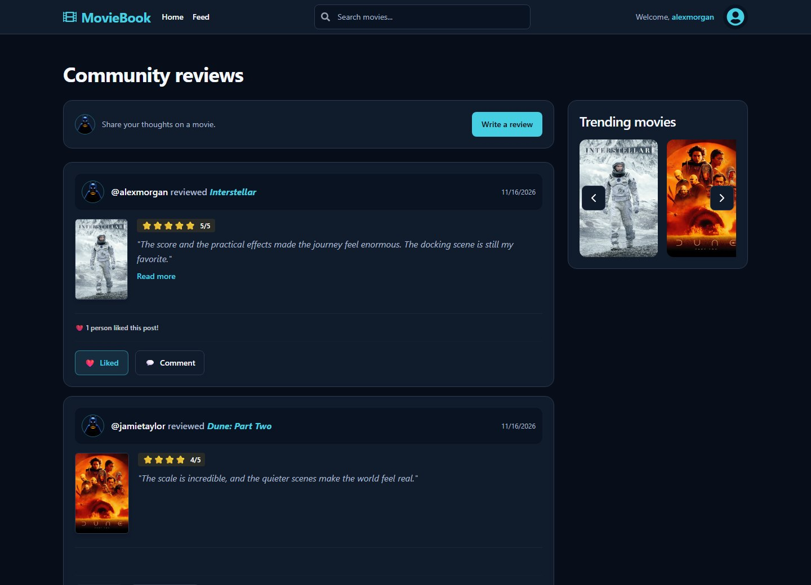
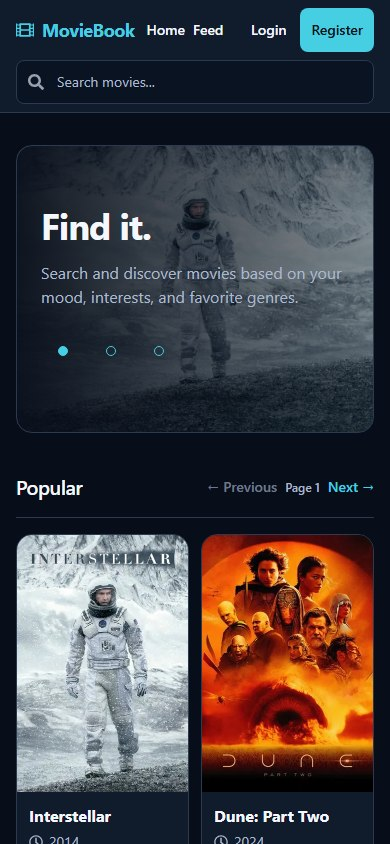
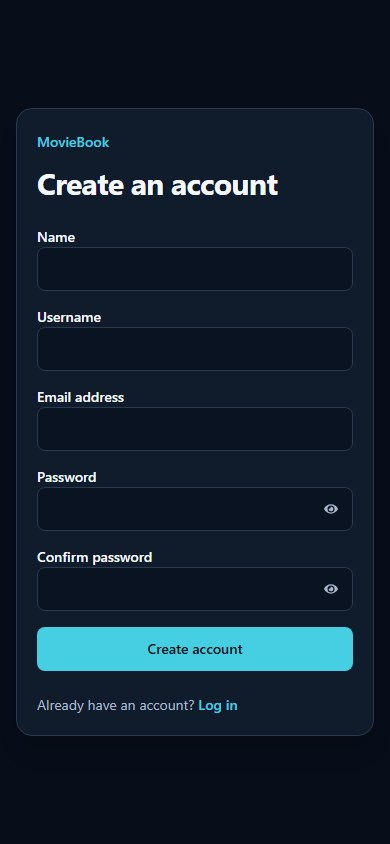

# MovieBook

MovieBook is a film discovery and review app built for the SKG Education Web Development Bootcamp. Browse the TMDB catalog, search for a title, watch official trailers when available, and share reviews and comments with the community.

## Screenshots

Captured from the production build using a local MongoDB database, demo accounts, and a sample movie catalog.

| Desktop | |
| --- | --- |
|  |  |
|  | |

| Mobile home | Mobile account creation |
| --- | --- |
|  |  |

## Run locally

Use Node.js 24, npm, a reachable MongoDB instance, and a [TMDB API Read Access Token](https://developer.themoviedb.org/docs/authentication-application). Copy `api/.env.example` to `api/.env` and fill in `APP_KEY`, `DATABASE_URL` and `THEMOVIEDB_ACCESS_TOKEN`. To generate an application key, run `node -e "console.log(require('node:crypto').randomBytes(32).toString('hex'))"`.

Start the API and client in separate terminals from the repository root.

```sh
cd api
npm ci
npm run dev
```

```sh
cd client
npm ci
npm run dev
```

Open [the client](http://localhost:5173). The Vite development server forwards `/api` to `http://localhost:8000`. If you change the API port, set `VITE_API_URL` in `client/.env` to the new API URL, including `/api`.

## Build and deploy

- **API** · Run `npm ci` and `npm run build` in `api/`. Start with `npm start` and set `NODE_ENV=production`. The runtime needs `dist/`, production dependencies and `swagger.yaml` next to `dist/`. A hosting provider's `PORT` takes precedence over `APP_PORT`.
- **Client** · Run `npm ci` and `npm run build` in `client/`. Serve `client/dist/` as static files and rewrite frontend routes such as `/movies/157336` to `index.html`. Keep the API proxy and static assets outside that rewrite.
- **HTTPS and routing** · The simplest setup serves the client and API on one HTTPS origin and forwards `/api/*` to Express. The session cookie is HTTP-only, secure in production and uses `SameSite=Strict`. If you use separate origins on the same site, set the exact client origin in `FRONTEND_URL` and set `VITE_API_URL` to the API's absolute URL including `/api` before building the client.
- **Readiness** · Point the host's health check at `GET /api/health`. It returns `200` while MongoDB is connected. Swagger UI is available under `/docs` on the API service.

| Environment variable | Where | Purpose |
| --- | --- | --- |
| `APP_KEY` | API only | Secret used to sign sessions |
| `DATABASE_URL` | API only | MongoDB connection string |
| `THEMOVIEDB_API_URL` | API only | Use `https://api.themoviedb.org/3` for TMDB |
| `THEMOVIEDB_ACCESS_TOKEN` | API only | TMDB API Read Access Token |
| `APP_URL` | API | Public base URL displayed in startup logs |
| `FRONTEND_URL` | API | Allowed frontend origin, without a path |
| `VITE_API_URL` | Client build | Optional. Defaults to `/api` |

Before opening registration publicly, verify on staging that a session survives a refresh, a profile edit persists, two distinct accounts can edit only their own content, and a movie trailer opens or shows the unavailable state.

## Credits

Frontend by Stauros Vetsikas, Eleni Zagora and Vasiliki Papantonopoulou. Backend by Prodromos Pantos, Stelios Metaxas and Giwrgos Sarafas.

Film metadata and artwork come from [The Movie Database](https://www.themoviedb.org). This product uses the TMDB API but is not endorsed or certified by TMDB. The [TMDB logo by Travis Bell](https://commons.wikimedia.org/wiki/File:Tmdb.new.logo.svg) is included unchanged under [CC BY-SA 4.0](https://creativecommons.org/licenses/by-sa/4.0/).
